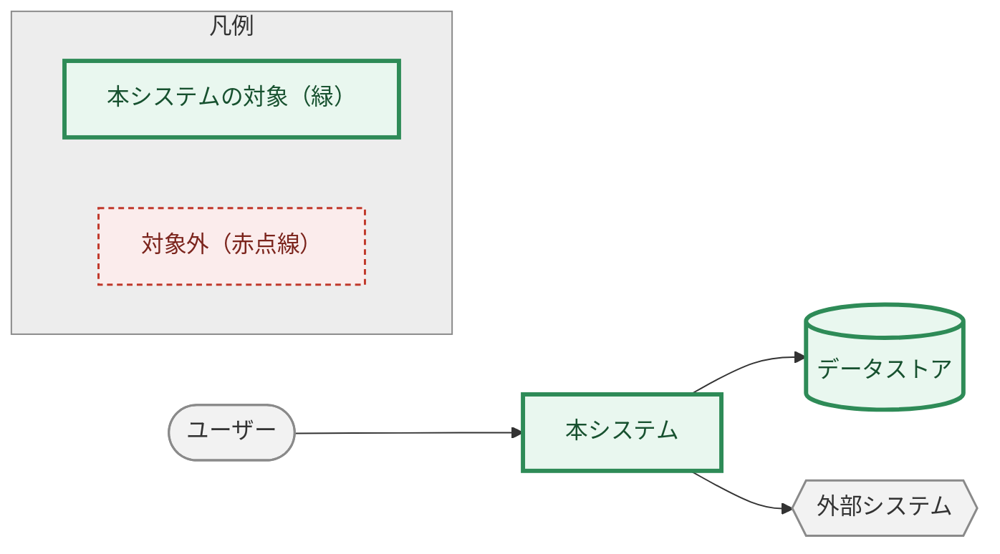

# RDRA 図の配色規約（Mermaid）

P01〜P04 で mermaid 図を描くときは、この規約に従う。自己流の配色・形を編み出さない。

## 原則: 形＝種類、色＝判定

**形**は要素の種類を表す。図が変わっても形の意味は変えない。

| 種類 | 形 | 記法 |
|------|-----|------|
| 人（アクター） | 角丸（スタジアム型） | `U(["名称"])` |
| 本システムの構成要素 | 四角 | `PAP["名称"]` |
| 外部システム・外部依存 | 六角形 | `EXT{{"名称"}}` |
| データストア・情報 | 円筒 | `KB[("名称")]` |
| 時間イベント | 円 | `TM((名称))` |

**色**は、その図で下している判定を表す。図ごとに判定の中身は変わるが、色の意味は固定する。

| 色 | `classDef` 名 | 意味 | スタイル例 |
|----|--------------|------|-----------|
| 緑 | `scope_in` | スコープ内（対象・扱う） | `fill:#E9F7EF,stroke:#2E8B57,stroke-width:3px,color:#17512F` |
| 赤・点線 | `scope_out` | スコープ外（対象外・扱わない・廃止） | `fill:#FBECEC,stroke:#C0392B,stroke-width:1.5px,color:#7B241C,stroke-dasharray:4 3` |
| 黄・点線 | `check` | 要確認・未定 | `fill:#FFF8E1,stroke:#C98A00,stroke-width:1.5px,color:#5A3E00,stroke-dasharray:4 3` |
| グレー | `neutral` | 判定対象外（アクター・外部依存など、スコープ判定自体が無い要素） | `fill:#F2F2F2,stroke:#8A8A8A,stroke-width:1.5px,color:#333` |

図ごとに判定の中身が変わる例（色は同じ、何を判定しているかが違う）:

- システムコンテキスト図: 本システムのスコープ内か（緑）／廃止・移行元か（赤点線）／判定対象外（グレー）
- BUC図・業務の全体像: システム化対象か（緑）／対象外か（赤点線）
- 情報モデル: 本システムで扱うか＝○（緑）／扱わない＝×（赤点線）／要確認（黄点線）

4色すべてを毎回使う必要はない。その図で実際に使う判定だけを `classDef` で定義する。

## 凡例は図そのものに描く（テキスト説明で済ませない）

`subgraph legend["凡例"]` として、実際に使うクラスのサンプルノードを並べる。
mermaid の `subgraph` は既定で薄い黄色の背景になるため、他のグループ枠（BUC図や業務の
全体像にある業務グループなど）と区別がつかなくなる。**`style legend fill:#EDEDED,...`
で明示的にグレーへ固定する。**

## 検証した描画環境

- `@mermaid-js/mermaid-cli` **10.9.1 と 11.4.2 の両方**で描画を確認済み（GitHub のレンダラは
  概ねこの範囲のバージョンに追従する）。`@{ icon: "fa:..." }` 記法（別パッケージからアイコンを
  取得する形）は外部取得に失敗しやすく、GitHub 上での表示が保証できないため使わない。
- `C4Context`（`Person()` / `SystemDb()` が本物の人型・円筒アイコンになる記法）は見た目は
  優れるが、ノードが10個を超えると自動レイアウトが崩れて矢印が交差する。**ノード数が多い
  コンテキスト図では C4 を避け、この規約の形＋色で表す。**

## Pitfalls

- 図ごとに「何を判定しているか」の意味が異なるので、その図の直前に一文だけ注記を置く
  （「緑＝対象、赤点線＝対象外」等）。色の対応表自体はこのファイルを参照させれば足り、
  各 README には書き写さない。
- `classDef` はその図で使うクラスだけを定義する。使わない色のクラスを定義しても
  描画エラーにはならないが、凡例に出さないクラスを定義すると凡例と図の対応が崩れて見える。
