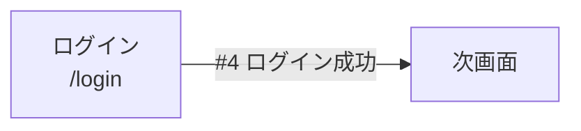

---
tags:
  - screen-design
  - frontend
  - login
source: src/pages/login/index.tsx
updated: YYYY-MM-DD
source_commit: <git SHA>
---

# 画面機能仕様書 - ログイン

> **注記**: ファイルパス・行番号は source_commit 時点のソースに基づく。

## 1. 基本情報

| 項目 | 内容 |
|------|------|
| 画面名 | ログイン |
| 画面ID | SCR-001 |
| パス | `/login` |
| 概要 | メールアドレスとパスワードで認証する画面。成功後は次画面へ遷移する。 |
| ページコンポーネント | `src/pages/login/index.tsx` |
| 認証 | 不要 |
| レイアウト | default |
| SSR/SSG | CSR |

## 2. 操作権限

| ユーザー | 認証状態・権限 | 動作 |
|--------|--------------|------|
| 全ユーザー | 未ログイン | ログインフォームを操作可能 |

## 3. 前提条件

- （この画面が依存する環境変数・クエリパラメータ等を記載）

## 4. イベント一覧

| 識別ID | イベント名 | 処理概要 |
|--------|-----------|---------|
| 1 | 初期表示 | フォーム初期化 |
| 2 | メールアドレス入力 | リアルタイムバリデーション |
| 3 | パスワード入力 | リアルタイムバリデーション |
| 4 | ログインボタン押下 | ログインAPI呼び出し→次画面へ遷移 |

**採番ルール**: #1は初期表示、#2以降はJSX上の出現順。

## 5. イベント処理詳細

### イベント識別ID: #4 ログインボタン押下

**定義箇所**: `src/pages/login/index.tsx`

1) ログインAPIを呼び出す

**API通信**:
| API | メソッド | リクエスト | レスポンス使用先 | 定義箇所 |
|-----|---------|----------|---------------|---------|
| ユーザーログイン (`/api/d/account/login` = API-001) | POST | username, password | session | `src/pages/login/index.tsx` |

**レスポンスに応じたエラー分岐**:
| No | 条件 | 結果 |
|----|------|------|
| 1 | HTTP 401 | 「メールアドレスまたはパスワードが間違っています。」を表示 |

## 6. 画面遷移

## 7. 状態管理（技術参照）

### 7.1 ローカルstate
| state名 | 型 | 初期値 | 用途 | 定義箇所 |
|---------|-----|-------|------|---------|
| | | | | |

### 7.2 グローバルstore
| store | 参照/更新値 | 用途 | 定義箇所 |
|-------|------------|------|---------|
| | | | |

### 7.3 URLパラメータ
| パラメータ | 型 | 用途 | 取得箇所 |
|-----------|-----|------|---------|
| | | | |

## 8. 備考・要確認事項

-

## 9. 画面レイアウト

- 初期表示 — 
