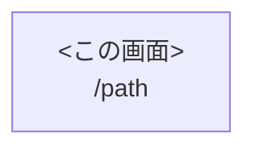

---
tags:
  - screen-design
  - frontend
source: <path/to/component.tsx>
updated: YYYY-MM-DD
source_commit: <このドキュメントが基づくソースのgit SHA>
figma_url: <FigmaファイルのURL。未定なら空>
figma_node_id: <書き出し対象フレームのnode-id（例: 123:456）。画像自動取得に使用>
design_status: draft   # draft | in-review | approved
design_version: <Figma側のバージョン名/日付。レビュー反映のたびに更新>
---

# 画面機能仕様書 - <画面名>

> **注記**: 本ドキュメント内のファイルパス・行番号は source_commit 時点のソースコードに基づく。
> コード変更により行番号がずれる可能性がある。

<!-- Why(なぜこの設計にしたか)はここに書かず ADR に集約し、必要なら本文から `ADR-xxxx` で参照する。
     横断的な共通仕様は各節に転記せず docs/specs/common/ を「N節参照」で参照する。 -->

## 1. 基本情報

| 項目 | 内容 |
|------|------|
| 画面名 | |
| 画面ID | <ID採番規則に従う。例: SCR-001> |
| パス | `/...` |
| 概要 | |
| ページコンポーネント | `path:行範囲` |
| 認証 | 要 / 不要 |
| レイアウト | |
| SSR/SSG | |

## 2. 操作権限

| ユーザー | 認証状態・権限 | 動作 |
|--------|--------------|------|
| | | |

## 3. 前提条件

<!-- 環境変数・クエリパラメータ・localStorage等、この画面が依存する前提を列挙 -->
-

## 4. イベント一覧

| 識別ID | イベント名 | 処理概要 |
|--------|-----------|---------|
| 1 | 初期表示 | |

**採番ルール**: <#1は初期表示、#2以降はJSX上の出現順、等のルールを明記>

## 5. イベント処理詳細

### イベント識別ID: #1 初期表示

**定義箇所**: `path:行範囲`

1)

**エラーハンドリング**:
| No | 条件 | 結果 |
|----|------|------|
| 1 | | |

<!-- 以降、#2, #3... を同じ形式で記述。API通信を伴うイベントは下記を含める:
     - API通信表（API / メソッド / リクエスト / レスポンス使用先 / 定義箇所）
     - レスポンスに応じたエラー分岐表（HTTPステータスごと） -->

## 6. 画面遷移

<!-- 流入元は対象パスを全ページGrepして特定した根拠(ファイル:行)を明記する -->

## 7. 状態管理（技術参照）

### 7.1 ローカルstate

| state名 | 型 | 初期値 | 用途 | 定義箇所 |
|---------|-----|-------|------|---------|
| | | | | |

### 7.2 グローバルstore

<!-- Redux/zustand/Context のいずれか。参照/更新する値と用途 -->
| store | 参照/更新値 | 用途 | 定義箇所 |
|-------|------------|------|---------|
| | | | |

### 7.3 URLパラメータ

| パラメータ | 型 | 用途 | 取得箇所 |
|-----------|-----|------|---------|
| | | | |

## 8. 備考・要確認事項

<!-- デッドコード・未使用state・想定用途不明な設計・要確認事項など -->
-

## 9. 画面レイアウト

確定デザインのスクリーンショット。リンク切れ検出と目視確認のための節。
画像は `screenshots/` 配下に置く（配置規約は screens/README.md 参照）。
Figma連携時は `scripts/figma-export/export.sh` で frontmatter の figma_node_id から自動取得できる。

- <パターン名> — 

## 10. デザインレビュー履歴

Figma上の客先フィードバックの「結論」だけをここに転記する（やり取り自体はFigmaに残す）。
frontmatter の design_status（draft→in-review→approved）はここの最新状況と一致させる。

| 日付 | 指摘元 | 指摘内容 | 対応 | 反映後 design_version |
|------|--------|---------|------|----------------------|
| YYYY-MM-DD | 客先/社内 | | 反映 / 見送り(理由) / 要確認 | |
